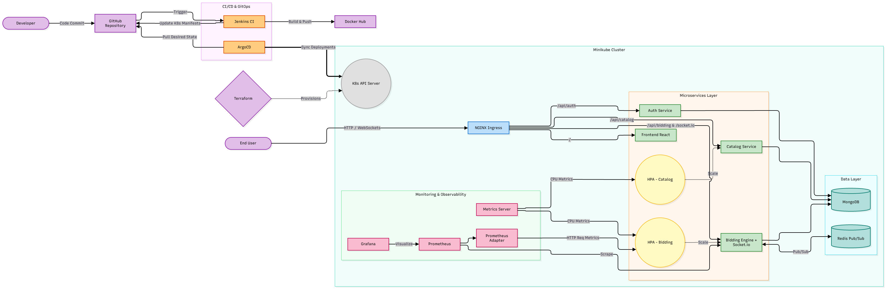
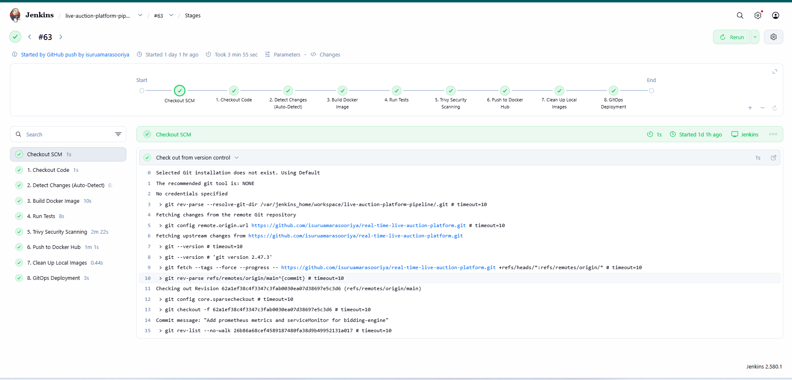
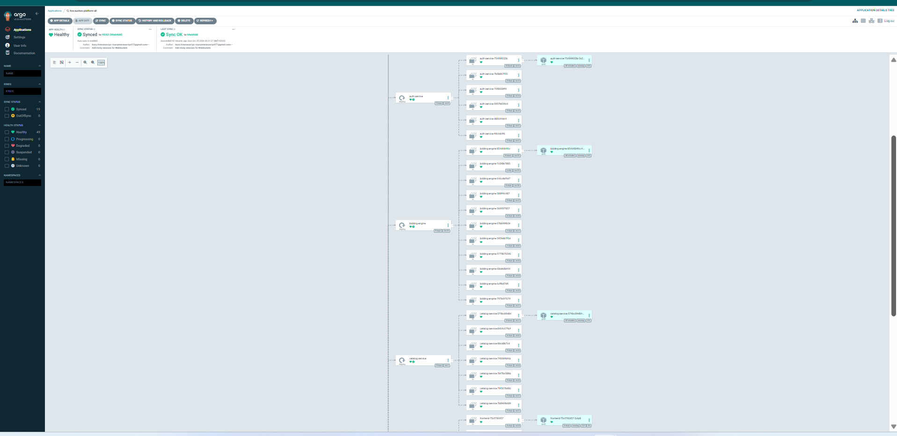

# Real-Time Live Auction Platform 🚀

An enterprise-grade, cloud-native microservices application demonstrating a complete end-to-end GitOps workflow, CI/CD automation, and custom metric-based autoscaling on Kubernetes. 

This project simulates a real-time bidding environment utilizing WebSockets, distributed databases, and modern DevOps practices to ensure high availability, security, and scalability.

## ✨ Architecture & Tech Stack

The infrastructure and application lifecycle are entirely automated using the principles of Infrastructure as Code (IaC) and GitOps.

*   **Application Layer:** Node.js (Express), React, Socket.io
*   **Data Layer:** MongoDB (Persistent Storage), Redis (Pub/Sub Adapter for WebSockets)
*   **Containerization & Orchestration:** Docker, Kubernetes (Minikube)
*   **Infrastructure as Code (IaC):** Terraform, Helm
*   **CI/CD Pipeline:** Jenkins (Groovy Pipeline), GitHub Webhooks
*   **GitOps Continuous Deployment:** ArgoCD
*   **Security:** Trivy (Container Vulnerability Scanning), Kubernetes Sealed Secrets
*   **Routing & Networking:** NGINX Ingress Controller
*   **Observability & Autoscaling:** Prometheus, Grafana, Prometheus Adapter, Metrics Server, Horizontal Pod Autoscaler (HPA)



## ✨ Key Engineering Features

1.  **Fully Automated CI/CD Pipeline (Jenkins):** 
    *   Implements a smart build strategy that auto-detects code changes in specific microservices to prevent redundant builds.
    *   Integrates **Trivy** for automated vulnerability scanning of Docker images before pushing to Docker Hub.
    *   Automatically updates Kubernetes manifests with new image tags and pushes changes back to the repository using `[skip ci]` to prevent pipeline loops.
2.  **GitOps Deployment (ArgoCD):** 
    *   ArgoCD continuously monitors the `k8s/` directory in the repository and automatically synchronizes the desired state into the Kubernetes cluster.
3.  **Custom Metric-Based Autoscaling (HPA):** 
    *   The `bidding-engine` utilizes a custom Prometheus metric (`http_requests_per_second`) routed via Prometheus Adapter to scale pods from 1 to 5 dynamically during traffic spikes.
    *   The `catalog-service` utilizes standard CPU-based Horizontal Pod Autoscaling.
4.  **Real-Time WebSocket Synchronization:** 
    *   Uses Socket.io backed by a Redis Pub/Sub adapter to ensure that real-time bids are instantly synchronized across all active replicas of the Bidding Engine.
5.  **Infrastructure as Code:** 
    *   Terraform provisions all baseline cluster infrastructure including ArgoCD, Kube-Prometheus-Stack, Metrics Server, MongoDB, and Redis via Helm charts.

## 📂 Repository Structure

```text
.
├── auth-service/          # Node.js REST API for JWT authentication
├── catalog-service/       # Node.js REST API for auction item retrieval
├── bidding-engine/        # Node.js Socket.io server with Prometheus custom metrics
├── frontend/              # React application built with Vite
├── k8s/                   # Kubernetes manifests managed by ArgoCD (Kustomize)
│   ├── auth-service/
│   ├── bidding-engine/
│   ├── catalog-service/
│   ├── frontend/
│   └── shared/            # Ingress rules and Sealed Secrets
├── terraform/             # Terraform configurations for Helm releases
└── Jenkinsfile            # Declarative CI/CD pipeline definition
```

## 🚀 Getting Started

### Prerequisites
*   Docker & Minikube installed (`minikube start --cpus 4 --memory 8192`)
*   Terraform installed
*   Kubectl and Helm CLI installed
*   Minikube addons enabled: `minikube addons enable ingress && minikube addons enable metrics-server`

### 1. Provision Infrastructure
Navigate to the terraform directory and apply the configuration to install databases, monitoring tools, and ArgoCD.
```bash
cd terraform
terraform init
terraform apply -auto-approve
```

### 2. Configure Secrets
Ensure you have Kubernetes Sealed Secrets controller installed. Generate your sealed secrets for MongoDB URI, Redis password, JWT Secret, and DockerHub credentials, placing them in `k8s/shared/`.

### 3. Deploy via GitOps
Apply the ArgoCD Application manifest to initiate the GitOps synchronization process.
```bash
kubectl apply -f terraform/argocd-application.yaml
```

### 4. Access the Application
Since the platform uses an NGINX Ingress Controller, start the Minikube tunnel in a separate terminal:
```bash
minikube tunnel
```
*   **Frontend UI:** `http://localhost`
*   **ArgoCD Dashboard:** Retrieve the initial admin password and port-forward the ArgoCD server service.
*   **Grafana Dashboard:** Port-forward the `prometheus-grafana` service to view real-time HPA scaling and custom HTTP metrics.

## 🧪 Testing Autoscaling

A stress-testing endpoint is exposed on the Bidding Engine to simulate high CPU and request loads.
```bash
kubectl run -i --tty load-generator --rm --image=alpine --restart=Never -- sh -c "apk add --no-cache curl && while true; do curl -X POST -s http://bidding-engine-svc:80/api/bidding/health-stress > /dev/null; done"
```
Monitor the autoscaling in real-time:
```bash
kubectl get hpa bidding-engine-hpa -w
```

## 📸 Project Screenshots


### CI/CD Automation Pipeline (Jenkins)


### Continuous Deployment & GitOps (ArgoCD)
